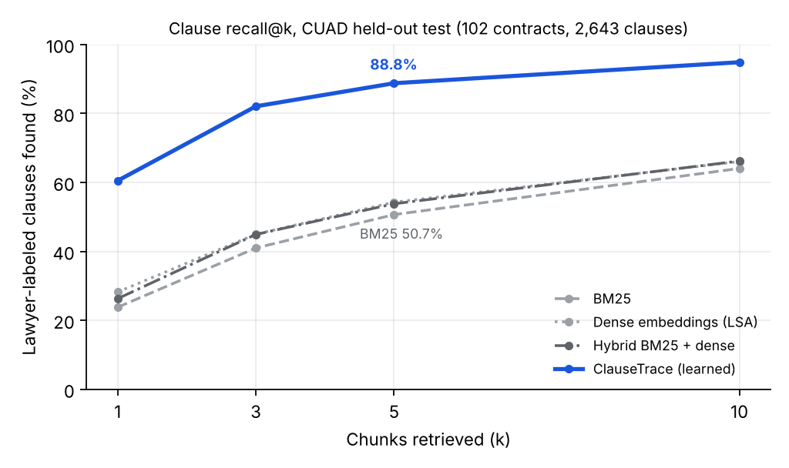

# ClauseTrace

**Find the clause a lawyer needs in a contract, quote it verbatim, and prove where it came from.**

ClauseTrace is a retrieval and grounded-extraction system for commercial contracts, evaluated against
**2,643 lawyer-labeled clauses** in the held-out test split of [CUAD](https://www.atticusprojectai.org/cuad)
(102 contracts, 41 clause categories, The Atticus Project).

| Held-out test (102 contracts) | Generic RAG retrieval (BM25) | ClauseTrace |
|---|---|---|
| Lawyer-labeled clauses found in top 5 chunks | 50.7% | **88.8%** |
| Questions where at least one gold clause is in top 5 | 66.3% | **96.2%** |
| Mean reciprocal rank of first relevant chunk | 0.529 | **0.900** |
| Share of the contract sent to the model (median) | 13.3% | **12.9%** |
| Clause present vs absent, across all 4,182 questions | n/a | **AUROC 0.961, F1 0.855** |

Retrieval takes **11 ms per request (p50)** on 2 CPU cores. At k=5 the prompt carries about **87% fewer
input tokens** than the full contract (estimated at 4 characters per token).



## Why this problem

Lawyers can't use an answer they can't trace back to the document, and missing a clause costs far more
than reading an extra paragraph. That makes the two jobs:

1. **Retrieval has to find the clause.** If the right text never reaches the model, no prompt can fix it.
2. **Every quote has to be verifiable.** A paraphrase that sounds right is worse than "not found".

The main finding: **off-the-shelf RAG retrieval misses about half of lawyer-labeled clauses.** BM25, dense
embeddings and their hybrid all land between 50% and 54% recall@5. Legal clauses are worded in many ways
("this Agreement shall be construed in accordance with..." never says "governing law"), so query-to-chunk
similarity isn't enough. A scorer trained on lawyer labels from *other* contracts closes most of that gap.

## How it works

```
contract ──► chunker (1,200 chars, 300 overlap, sentence-snapped, exact char offsets)
                │
category ──► learned clause scorer (per-category logistic regression over TF-IDF n-grams,
                │                    trained on lawyer labels from training contracts only;
                │                    BM25 fallback for categories with < 2 labels)
                ▼
         top-k chunks ──► LLM (Claude or Gemini): verbatim quotes tagged with excerpt id, or NOT FOUND
                                │
                                ▼
                     citation verifier: each quote must be a verbatim substring of an excerpt
                     (whitespace-tolerant only) and is mapped to absolute contract offsets
                                │
                 failed quote or NOT FOUND? ──► re-retrieve with k=10, tell the model which
                                │               quotes failed, retry once
                                ▼
                     only verified quotes are returned; unverifiable text never reaches the user
```

## Evaluation method

- **Splits.** CUAD's official 102-contract test split is held out. The 408 training contracts are split
  80/20 by a deterministic hash into train and dev. Chunk size, fusion weights and the presence threshold
  were tuned **on dev only**, then frozen. The test script refuses to tune on test.
- **Recall@k is span-level and strict.** A gold clause counts as found only if the top-k chunks together
  cover at least 50% of its characters. "Any overlap" would overstate results.
- **Absent clauses count.** 70% of CUAD questions have no answer. Presence detection is scored across all
  4,182 test questions, not only the ones with an answer.
- **Dev → test consistency.** Learned recall@5 was 87.4% on dev and 88.8% on test, so there's no sign of
  overfitting to dev.

### Full test results

| Retriever | Recall@1 | Recall@3 | Recall@5 | Recall@10 | Hit@5 | MRR |
|---|---|---|---|---|---|---|
| BM25 | 23.8% | 41.0% | 50.7% | 64.1% | 66.3% | 0.529 |
| Dense (LSA embeddings) | 28.2% | 45.0% | 54.3% | 66.1% | 69.7% | 0.582 |
| Hybrid BM25 + dense (RRF) | 26.3% | 44.9% | 53.8% | 66.2% | 69.3% | 0.568 |
| **ClauseTrace learned scorer** | **60.5%** | **82.1%** | **88.8%** | **94.9%** | **96.2%** | **0.900** |
| Learned + BM25 + dense (RRF, dev-tuned) | 51.8% | 79.2% | 88.6% | 94.5% | 96.1% | 0.858 |

### Chunk-size tuning (dev, learned scorer)

| Chunk size | Recall@5 | Recall@10 | MRR | Contract sent @5 |
|---|---|---|---|---|
| 500 | 77.7% | 86.9% | 0.897 | 3.5% |
| 800 | 84.0% | 91.8% | 0.904 | 5.7% |
| **1,200** | **87.4%** | **94.6%** | **0.914** | 8.8% |

### Decisions the data made

- **No hybrid fusion in the shipped system.** Fusing the learned scorer with BM25 and embeddings matched it
  at recall@5 (88.6% vs 88.8%) and lowered MRR (0.858 vs 0.900). Fusion added complexity with no gain, so
  ClauseTrace uses the learned scorer alone.
- **Retry on "not found" is on by default.** A missed clause is the expensive error in contract review, so
  a NOT FOUND is re-checked with twice the context. `--no-retry-on-not-found` turns it off to save cost.

### Where it fails

Weakest categories at recall@5: **Post-Termination Services (61%)**, **Minimum Commitment (67%)**,
**IP Ownership Assignment (70%)**, ROFR/ROFO/ROFN (76%). These clauses are worded inconsistently and often
spread across several sections. Clear-cut categories reach 100%: Governing Law (90 clauses), Renewal Term
(31), No-Solicit of Employees (18). Per-category numbers are in `results/retrieval_test.json`.

## Model comparison (grounded extraction)

`scripts/run_generation_eval.py` runs the full pipeline on a seeded, balanced sample of test questions
(half with the clause present, half absent) and compares models on the same inputs:

- **presence F1:** does the model correctly say the clause is present or absent
- **span precision / recall:** character overlap between verified quotes and lawyer-labeled spans
- **rejected-quote rate:** share of model quotes that weren't verbatim in the sources (caught by the
  verifier, never shown)
- **retry rate, p50/p95 latency, input tokens vs the full contract**

```bash
export ANTHROPIC_API_KEY=...  GEMINI_API_KEY=...
python scripts/run_generation_eval.py --models anthropic:claude-haiku-5-5 anthropic:claude-sonnet-5-5 google:<gemini-model> --n 100
```

Results are written to `results/generation_models_n100.json`. *(Results table to be added after the run.)*

## Run it

```bash
pip install -r requirements.txt
./scripts/fetch_cuad.sh                                  # CUAD v1, CC BY 4.0
python -m unittest discover -s tests -t .                # 18 tests
python scripts/run_retrieval_eval.py --split dev         # tune
python scripts/run_retrieval_eval.py --split test --weights 0,0.5,3 --presence-threshold 0.659
python scripts/run_generation_eval.py --models mock --n 20   # offline end-to-end dry run, no keys
```

Optional neural embeddings for the dense baseline: `pip install sentence-transformers`, then add
`--embedder st` (all-MiniLM-L6-v2). The default LSA embedder is trained on the training contracts and
needs no model download.

## Layout

```
clausetrace/
  data.py        CUAD loader, deterministic train/dev/test splits
  chunking.py    offset-preserving, sentence-snapped chunker
  retrieval.py   BM25 (from scratch on sparse matrices), dense, learned scorer, RRF fusion
  metrics.py     span-level recall@k, hit@k, MRR, context fraction
  pipeline.py    fit/score/evaluate harness, clause-presence evaluation
  model.py       ClauseTrace: fit once, persist, rank per request
  generate.py    Claude/Gemini REST providers, prompt, citation verifier, self-correcting retry loop
scripts/         evaluation entry points, data fetch
tests/           unittest suite: chunking, retrieval, metrics, verification, retry behaviour
results/         every number in this README, as JSON
```

## Limitations

- The dense baseline is LSA, not a neural embedder, because the environment the results were produced in
  had no model downloads. `--embedder st` reruns it with MiniLM. A stronger embedder would narrow the gap
  to the learned scorer; rerun with `--embedder st` to measure by how much.
- The learned scorer depends on CUAD's fixed 41-category taxonomy. A brand-new clause type falls back to
  BM25 until labeled examples exist.
- CUAD covers commercial contracts filed with the SEC. Results may not transfer to litigation documents,
  court opinions or non-English contracts.

## License and data

Code: MIT. CUAD v1 © The Atticus Project, CC BY 4.0. The data isn't redistributed here;
`scripts/fetch_cuad.sh` downloads it.
